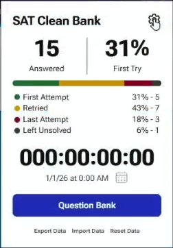

# Not affiliated with or endorsed by College Board. SAT is a registered trademark of College Board.

# SAT-Clean-Bank
Chrome extension for Collegeboard's SAT Question Bank.

**Currently still in development**.

Planned release before 11/7/26.

## Installation

### 1a. Clone the repo
```bash
git clone "https://github.com/shiwntr/SAT-Clean-Bank.git"
```

### 1b. Or download the repo zip and extract it.

### 2. Go to chrome extensions

chrome://extensions

### 3. Enable developer mode if not enabled already.
### 4. Press load unpacked.
### 5. Select the folder.

## Features
+ Replaces the default question layout with a custom UI.
+ Select answers, check your responses, and receive immediate visual feedback.
+ Displays correct answers, explanations, and breakdowns of incorrect choices.
+ Tracks total questions answered, first attempt success rate, and overall question progress.
+ Tracks incorrect attempts, solved questions, and first try performance.
+ Displays a quesion's state directly next to it in the question bank table.
+ Displays a live countdown to your selected test date you can choose.
+ Choose between 3 built in fonts.
+ Hide or show the question bank's export options.
+ Back up your progress and settings and restore them later.
+ Ability to reset saved progress and extension settings.
+ Quick access to the question bank directly from the extension.
+ **All** data is stored on your device.

## Screenshots




## Notes
+ Currently only supports Chrome
+ Currently only supports Reading and Writing questions

## Planned features
+ Math support
