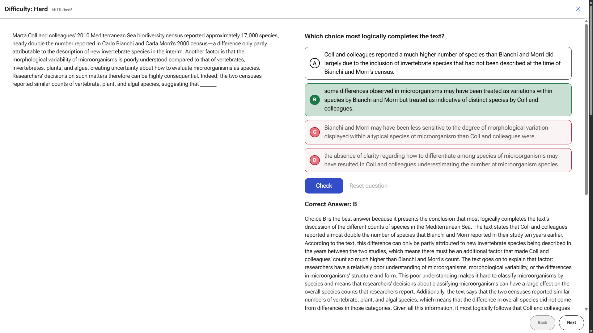
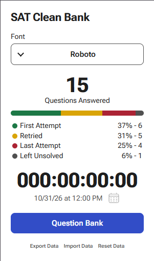

# SAT-Clean-Bank
Chrome extension for Collegeboard's SAT Question Bank.

**Currently still in development**.

Planned release before 11/7/26.

## Installation

#### 1. Clone the repo
```bash
git clone "https://github.com/shiwntr/SAT-Clean-Bank.git"
```

#### 2. Go to chrome extensions.

chrome://extensions

#### 3. Enable developer mode if not enabled already.
#### 4. Press load unpacked.
#### 5. Select the newly cloned repo.

## Screenshots




## Notes
+ Currently only supports Chrome

## Planned features
+ Quickly view question state from table
+ Animations
